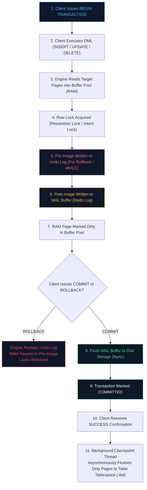

# 🚀 Day 14: DML, Atomic Upserts, ACID Transactions & Concurrency Control

Welcome to **Day 14** of the **SQL Mastery Intensive**. Today we transition from declarative read queries (`SELECT`) to state mutation physics: **Data Manipulation Language (DML)**, **Atomic Upserts**, **ACID Transactions**, and **Concurrency Control**.

In enterprise architectures, writing data safely is orders of magnitude more challenging than reading data. A single unshielded `UPDATE` can overwrite an entire production table; an unsynchronized inventory check can cause catastrophic overselling; and a misplaced transaction boundary can leave financial ledgers in an irrecoverable state.

---

## 🎯 Sprint Objectives

1. **Master Core DML Mutation Physics**:
   - Execute bulk multi-row inserts (`INSERT INTO ... VALUES (...)`).
   - Run safe, surgical `UPDATE` statements with join predicates and compound `WHERE` filters.
   - Perform cascading and soft deletions (`DELETE` vs `TRUNCATE` vs soft-delete flags).
   - Leverage the `RETURNING` clause (PostgreSQL/SQLite) for zero-latency mutation feedback without secondary roundtrips.

2. **Architect Idempotent Upsert Pipelines**:
   - Implement PostgreSQL/SQLite `INSERT INTO ... ON CONFLICT (key) DO UPDATE` / `DO NOTHING`.
   - Implement MySQL `INSERT INTO ... ON DUPLICATE KEY UPDATE`.
   - Implement ANSI SQL standard `MERGE INTO target USING source ON (...)`.
   - Guarantee idempotency in distributed event ingestion (handling at-least-once webhook deliveries).

3. **Demystify ACID Internals & Storage Physics**:
   - **Atomicity**: All-or-nothing execution with `BEGIN`, `COMMIT`, `ROLLBACK`, and nested `SAVEPOINT` recoveries.
   - **Consistency**: Enforcing business integrity via `CHECK`, `FOREIGN KEY`, and unique constraints.
   - **Isolation**: Diagnosing the 4 ANSI SQL isolation levels (Read Uncommitted, Read Committed, Repeatable Read, Serializable) and preventing dirty reads, non-repeatable reads, and phantom reads.
   - **Durability**: Write-Ahead Logging (WAL / Redo Log), doublewrite buffers, OS page cache flushing (`fsync`), and crash recovery checkpoints.

4. **Engine Concurrency & Locking Mechanics**:
   - Deploy **Pessimistic Row Locking** with `SELECT ... FOR UPDATE` and `FOR SHARE`.
   - Build lock-free, zero-contention job queues with `SELECT ... FOR UPDATE SKIP LOCKED`.
   - Prevent race conditions and lost updates using **Optimistic Concurrency Control (OCC)** with version tokens.
   - Understand Multi-Version Concurrency Control (MVCC) snapshot reads, Undo log rollback segments, and deadlock graph resolution.

---

## 🗺️ Problem Matrix

| # | Benchmark Problem Name | Difficulty | Core SQL Concepts Tested | Enterprise Architecture Archetype | Status |
|:---:|:---|:---:|:---|:---|:---:|
| 1 | **High-Throughput Idempotent Webhook Upsert Pipeline** | Medium | `INSERT ... ON CONFLICT / ON DUPLICATE KEY`, Expression Upserts, Event Deduplication | Distributed Event Streaming | ✅ Solved |
| 2 | **Atomic Double-Entry Financial Ledger Transfer** | Hard | `BEGIN ... COMMIT`, Row Locking (`FOR UPDATE`), Check Constraints, Audit Journaling | Core Banking & Fintech | ✅ Solved |
| 3 | **Ultra-High-Throughput Lock-Free Task Queue** | Hard | `SELECT ... FOR UPDATE SKIP LOCKED`, CTE Mutation (`UPDATE ... RETURNING`), Worker Isolation | Distributed Async Task Broker | ✅ Solved |
| 4 | **SCD Type 2 Dimension Synchronization (Atomic Merge)** | Hard | `MERGE` / Multi-Stage DML Transaction, Historical Row Invalidation, Temporal Gaps | Enterprise Data Warehousing | ✅ Solved |

---

## 📊 Transaction Isolation Levels & Concurrency Anomalies

```
┌────────────────────────────────┬────────────┬─────────────────────┬──────────────┬────────────────┐
│ Isolation Level                │ Dirty Read │ Non-Repeatable Read │ Phantom Read │ Write Skew     │
├────────────────────────────────┼────────────┼─────────────────────┼──────────────┼────────────────┤
│ 1. READ UNCOMMITTED            │  Allowed   │       Allowed       │   Allowed    │    Allowed     │
│ 2. READ COMMITTED (PG Default) │ Prevented  │       Allowed       │   Allowed    │    Allowed     │
│ 3. REPEATABLE READ (MySQL Def) │ Prevented  │      Prevented      │ Prevented*   │    Allowed     │
│ 4. SERIALIZABLE                │ Prevented  │      Prevented      │  Prevented   │   Prevented    │
└────────────────────────────────┴────────────┴─────────────────────┴──────────────┴────────────────┘
* MySQL InnoDB prevents phantom reads in Repeatable Read using Next-Key gap locks during range queries.
```

---

## 🏗️ Architectural Flowchart: ACID Transaction Execution & The Write-Ahead Log (WAL)



---

## ⚡ Essential DML Syntax Blueprint

### 1. PostgreSQL / SQLite Atomic Upsert (`ON CONFLICT`)
```sql
INSERT INTO user_profiles (user_id, display_name, login_count, last_login_at)
VALUES (101, 'Alice Smith', 1, CURRENT_TIMESTAMP)
ON CONFLICT (user_id) 
DO UPDATE SET
    display_name = EXCLUDED.display_name,
    login_count = user_profiles.login_count + 1,
    last_login_at = EXCLUDED.last_login_at
RETURNING user_id, login_count, last_login_at;
```

### 2. MySQL Atomic Upsert (`ON DUPLICATE KEY UPDATE`)
```sql
INSERT INTO user_profiles (user_id, display_name, login_count, last_login_at)
VALUES (101, 'Alice Smith', 1, CURRENT_TIMESTAMP)
ON DUPLICATE KEY UPDATE
    display_name = VALUES(display_name),
    login_count = login_count + 1,
    last_login_at = VALUES(last_login_at);
```

### 3. Lock-Free Concurrent Queue Consumption (`SKIP LOCKED`)
```sql
-- Worker claims up to 5 pending tasks instantly without blocking other workers
WITH ClaimedTasks AS (
    SELECT task_id
    FROM task_queue
    WHERE status = 'PENDING'
    ORDER BY priority DESC, created_at ASC
    LIMIT 5
    FOR UPDATE SKIP LOCKED
)
UPDATE task_queue t
SET status = 'PROCESSING',
    worker_id = 'worker-node-04',
    started_at = CURRENT_TIMESTAMP
FROM ClaimedTasks c
WHERE t.task_id = c.task_id
RETURNING t.task_id, t.payload;
```

---

## 📂 Repository Contents
- [`THEORY.md`](file:///i:/sqlmastery%28github%29/sql-mastery/day-14-dml-atomic-upserts-acid/THEORY.md): Deep-dive academic theory on ACID, WAL mechanics, MVCC undo logs, locking models, and isolation anomalies.
- [`queries.sql`](file:///i:/sqlmastery%28github%29/sql-mastery/day-14-dml-atomic-upserts-acid/queries.sql): Full production-grade DML queries, schema definitions, stress tests, and transaction blocks.
- [`SOLUTIONS_BREAKDOWN.md`](file:///i:/sqlmastery%28github%29/sql-mastery/day-14-dml-atomic-upserts-acid/SOLUTIONS_BREAKDOWN.md): Line-by-line mechanical autopsy of all 4 enterprise benchmark problems.
- [`INTERVIEW_QUESTIONS.md`](file:///i:/sqlmastery%28github%29/sql-mastery/day-14-dml-atomic-upserts-acid/INTERVIEW_QUESTIONS.md): 10 rigorous senior staff database engineer interview questions with counter-intuitive traps.
- [`ASSESSMENT.md`](file:///i:/sqlmastery%28github%29/sql-mastery/day-14-dml-atomic-upserts-acid/ASSESSMENT.md): 10-question evaluation scorecard testing atomic mutations, deadlock prevention, and ACID properties.
- [`DAILY_LOG.md`](file:///i:/sqlmastery%28github%29/sql-mastery/day-14-dml-atomic-upserts-acid/DAILY_LOG.md): Personal execution log, key technical breakthroughs, and silent gotchas mastered.
