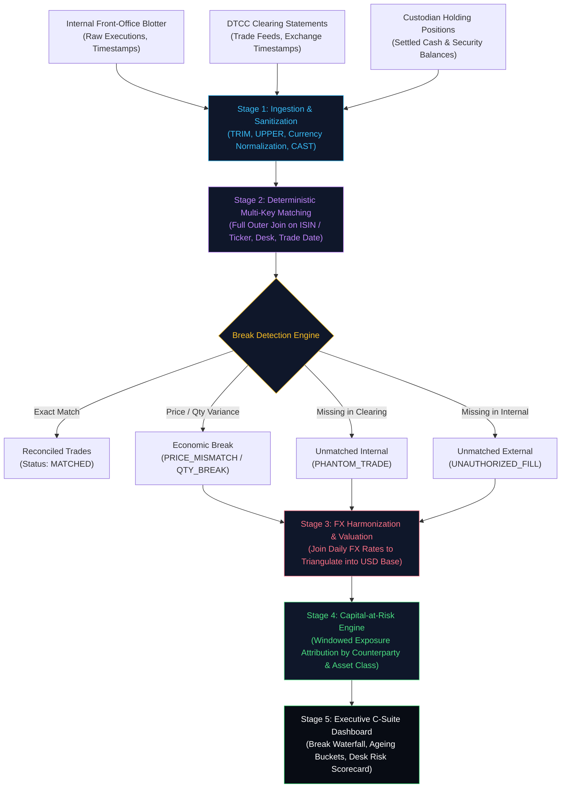

# 🏛️ Day 15 Grand Capstone: Multi-Asset Trade Settlement, Custody Breaks & Prime Broker Reconciliation Engine

Welcome to the **Grand Capstone Project** of the **SQL Mastery Intensive**. This project synthesizes every foundational, intermediate, and advanced SQL capability developed across the curriculum—Window Functions, Recursive CTEs, Non-Equi Joins, Set Operations, Atomic DML, and Concurrency Controls—into a mission-critical financial engineering platform.

---

## 💼 Executive Business Context

In tier-1 investment banks, hedge funds, and prime brokers (e.g., Goldman Sachs, Citadel, JPMorgan, BlackRock), trading desks execute billions of dollars across Equities, Fixed Income, Foreign Exchange (FX), and Derivatives daily. 

However, trading is only half the battle. Once an order is executed:
1. The **Internal Front-Office Blotter** records what traders *believe* happened.
2. The **Clearing House (DTCC / Euroclear)** records what was cleared over the wire.
3. The **Global Custodian Bank (BNY Mellon / State Street)** holds the actual physical securities and cash.

When these three records disagree, a **Settlement Break** occurs. In a $T+1$ settlement regime, failing to detect and resolve breaks within hours leads to:
- **Regulatory Fines** (SEC Rule 15c3-3, FINRA, MiFID II).
- **Counterparty Capital-at-Risk**: Millions of dollars tied up in failed deliveries.
- **Overnight Overdraft Penalties**: Custodian overdraft fees accrued at SOFR + 300 bps.

In this capstone, you engineer a **production-grade SQL Reconciliation Engine** that automates the full ingest-to-dashboard pipeline.

---

## 🎯 Architecture & Data Flow Pipeline



---

## 🗺️ Database Schema Topology

```
┌───────────────────────────────────────┐         ┌──────────────────────────────────────┐
│       internal_trade_blotter          │         │        dtcc_clearing_records         │
├───────────────────────────────────────┤         ├──────────────────────────────────────┤
│ PK trade_id          VARCHAR(50)      │         │ PK dtcc_ref_id       VARCHAR(50)     │
│    desk_code         VARCHAR(20)      │         │    executing_broker  VARCHAR(50)     │
│    ticker            VARCHAR(20)      │         │    ticker            VARCHAR(20)     │
│    isin              VARCHAR(12)      │         │    isin              VARCHAR(12)     │
│    side              VARCHAR(4)       │         │    side              VARCHAR(4)      │
│    trade_qty         NUMERIC(18,4)    │         │    cleared_qty       NUMERIC(18,4)   │
│    execution_price   NUMERIC(18,4)    │         │    clearing_price    NUMERIC(18,4)   │
│    currency          VARCHAR(3)       │         │    currency          VARCHAR(3)      │
│    trade_timestamp   TIMESTAMPTZ      │         │    cleared_timestamp TIMESTAMPTZ     │
│    counterparty_id   VARCHAR(30)      │         │    clearing_status   VARCHAR(20)     │
└───────────────────────────────────────┘         └──────────────────────────────────────┘
                   │                                                  │
                   └────────────────────┬─────────────────────────────┘
                                        ▼
                   ┌─────────────────────────────────────────┐
                   │        fx_daily_rates (FX Master)       │
                   ├─────────────────────────────────────────┤
                   │ PK rate_date         DATE               │
                   │ PK currency          VARCHAR(3)         │
                   │    usd_exchange_rate NUMERIC(14,6)      │
                   └─────────────────────────────────────────┘
                                        │
                                        ▼
                   ┌─────────────────────────────────────────┐
                   │         recon_settlement_breaks         │
                   ├─────────────────────────────────────────┤
                   │ PK break_id          SERIAL             │
                   │    trade_id          VARCHAR(50)        │
                   │    dtcc_ref_id       VARCHAR(50)        │
                   │    break_category    VARCHAR(30)        │
                   │    qty_delta         NUMERIC(18,4)      │
                   │    price_delta       NUMERIC(18,4)      │
                   │    exposure_usd      NUMERIC(18,2)      │
                   │    ageing_days       INT                │
                   │    severity          VARCHAR(10)        │
                   └─────────────────────────────────────────┘
```

---

## ⚡ The 5 Core Reconciliation Engineering Milestones

### 1. Ingestion Sanitization & Invariant Normalization
- Cleans irregular string feeds (trailing whitespaces, non-standardized ticker symbols).
- Resolves ISIN vs Ticker symbol ambiguity using hierarchical coalescing.
- Standardizes international timestamps into UTC ISO-8601 formatting.

### 2. Full Dual-Sided Matching & Discrepancy Triangulation
- Deploys a full outer join matching pipeline on `(COALESCE(i.isin, d.isin), side, trade_date)`.
- Classifies breaks into 4 discrete categories:
  - `PRICE_MISMATCH`: Execution price differs by $> \$0.005$.
  - `QUANTITY_BREAK`: Executed quantity differs from cleared quantity.
  - `PHANTOM_INTERNAL`: Present on internal blotter but missing in DTCC clearing.
  - `UNAUTHORIZED_EXTERNAL`: Present in DTCC clearing but unknown to trading desk.

### 3. Multi-Currency Triangulation (FX Normalization)
- Binds daily central bank FX rates (`EUR`, `GBP`, `JPY`, `CHF`, `HKD`).
- Computes gross notional exposure and net mark-to-market variances normalized to **USD Base**.

### 4. Capital-at-Risk (CaR) & Counterparty Exposure Scoring
- Aggregates capital-at-risk per broker-dealer counterparty (Morgan Stanley, UBS, Barclays, Virtu).
- Uses window frame ranking (`DENSE_RANK()`) to identify top counterparty risk concentrations.
- Flags transactions violating regulatory $T+1$ hard delivery thresholds.

### 5. Executive C-Suite Risk Dashboard & Break Ageing Waterfall
- Computes the executive break resolution rate:
  $$\text{Match Rate} = \frac{\text{Count of MATCHED Trades}}{\text{Total Trade Universe}} \times 100$$
- Classifies breaks into regulatory Ageing Buckets ($0\text{--}1 \text{ days}$, $2\text{--}3 \text{ days}$, $4+ \text{ days CRITICAL}$).
- Produces a CFO-ready settlement risk scorecard.

---

## 📁 Project File Manifest
- [`THEORY.md`](file:///i:/sqlmastery%28github%29/sql-mastery/day-15-enterprise-capstone/THEORY.md): Institutional clearing, settlement mechanics, DTCC netting, Swift messaging, and regulatory capital rules.
- [`schema.sql`](file:///i:/sqlmastery%28github%29/sql-mastery/day-15-enterprise-capstone/schema.sql): Production DDL with constraints, compound indexes, and audit tables.
- [`seed_data.sql`](file:///i:/sqlmastery%28github%29/sql-mastery/day-15-enterprise-capstone/seed_data.sql): Multi-asset institutional trade data featuring intentional real-world breaks.
- [`reconciliation_pipeline.sql`](file:///i:/sqlmastery%28github%29/sql-mastery/day-15-enterprise-capstone/reconciliation_pipeline.sql): Complete 5-stage SQL reconciliation engine.
- [`SOLUTIONS_BREAKDOWN.md`](file:///i:/sqlmastery%28github%29/sql-mastery/day-15-enterprise-capstone/SOLUTIONS_BREAKDOWN.md): Deep-dive technical autopsy and complexity analysis of every query.
- [`INTERVIEW_DEFENSE.md`](file:///i:/sqlmastery%28github%29/sql-mastery/day-15-enterprise-capstone/INTERVIEW_DEFENSE.md): Architecture defense walkthrough for Staff Data Engineer / Financial Tech interviews.
- [`DAILY_LOG.md`](file:///i:/sqlmastery%28github%29/sql-mastery/day-15-enterprise-capstone/DAILY_LOG.md): Sprint engineering log, performance benchmarks, and lessons learned.
